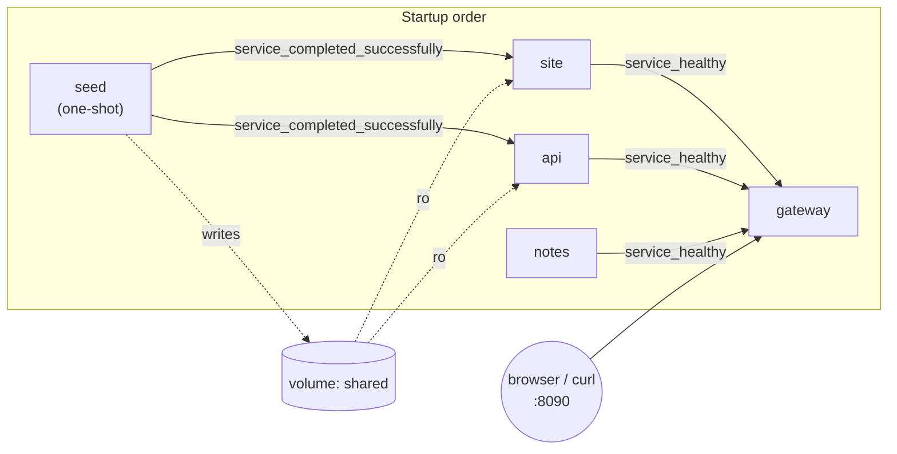

# docker compose watch

A small, vanilla Compose project for learning `docker compose watch`. Each watch feature has a
service where editing one file has a visible, checkable effect. `just demo` runs the whole tour on
its own: it edits each watched file, checks the result over HTTP, then restores everything.

Built and tested with **Docker Compose v5.5.1** (Engine 29.8.1).

## Quick start

Needs Docker Compose with the watch features listed below (tested on v5.5.1) and [just](https://github.com/casey/just).
Every recipe is a one-line `docker compose` command, so you can also run the commands directly.

```sh
just up        # = docker compose up --build --watch   (foreground, Ctrl-C stops everything)
```

Open http://localhost:8090 and edit files under `site/`, `notes/`, `api/` or `gateway/`. To use a
different port, set `GATEWAY_PORT=9000 just up`.

```sh
just demo      # hands-free tour of every action, with verification (needs nothing else running)
just status    # containers + one line per endpoint
just down      # remove containers, keep images/volume
just clean     # remove containers, the project's images and the named volume
```

`just` lists every recipe. Only `gateway` publishes a port (8090); the other services are
reachable only through it.

## What compose watch is

`develop.watch` on a service lists **rules**: a host `path`, an `action`, and usually a container
`target`. `docker compose watch` (or `up --watch`) watches those paths. When a file changes, Compose
**copies the file into the running container through the Docker API** and then, depending on the
action, does nothing more, restarts the container, runs a command in it, or rebuilds the image.

How it compares to the usual alternatives:

| | Bind mount (`./src:/app`) | Live-reload tool in the container (nodemon, `uvicorn --reload`) | compose watch |
|---|---|---|---|
| How files arrive | Host dir shared with the container | Still needs a bind mount (or watch) | Copied in through the API |
| Remote / other-distro / VM daemon | **Silently mounts an empty dir** | Same problem | Works: only the API is used |
| Host junk (`node_modules`, `.venv`, editor swap files) | All visible in the container | All visible | Filtered with `ignore` / `include` / `.dockerignore` |
| Dependency change | You rebuild by hand | You rebuild by hand | `action: rebuild` does it |
| Config needing restart | You restart by hand | Often not covered | `sync+restart` / `sync+exec` |
| Container image | Can diverge silently from the host files | Same | Each rebuild bakes the current files in |

It complements live-reload tools rather than replacing them: watch gets the files into the container,
and a reloader (if your stack has one) picks them up there.

In this repo the Docker daemon runs in a different WSL distro from the CLI, so bind mounts would
show empty directories. That's the main reason to use watch here: everything goes over the API,
including the build context.

## Actions demonstrated

| Action | Trigger (host file) | What happens | Demo service |
|---|---|---|---|
| `sync` | `site/html/**` | Files copied into `/usr/share/nginx/html`; nginx serves them on the next request. No restart | `site` |
| `sync` + `ignore` | `site/html/drafts/`, `*.tmp`, `*.swp` | Nothing: these never reach the container | `site` |
| `sync` + `initial_sync: true` | Edits made while watch was **not** running | Pushed into the container as soon as watch starts | `site` |
| `sync+exec` + `include` | `notes/content/*.txt` (only `.txt`) | File synced to `/src`, then `build-notes` runs **inside** the container and regenerates the page. The process is not restarted | `notes` |
| `sync+restart` | `gateway/nginx.conf` | File synced, then the container is restarted (nginx reads config only at startup) | `gateway` |
| `sync+restart` | `api/app.py` | File synced, Python process restarted. Same container, no build | `api` |
| `rebuild` | `api/pyproject.toml`, `api/uv.lock` | Image rebuilt (`uv sync` installs the new deps), then the container is recreated | `api` |
| `restart` | (not demonstrated) | Restarts the container without syncing anything. Useful when a watched file is already baked or mounted some other way | — |

Your Compose version supports every watch feature (it rejects unknown actions; `sync`, `restart`,
`sync+restart`, `sync+exec` and `rebuild` are all accepted, plus `ignore`, `include` and
`initial_sync`). So there's no "newer versions also offer…" list for this setup. On **older**
Compose v2 releases, `sync+restart`, `sync+exec`, `restart`, `include` and `initial_sync` were added
over time. If your version doesn't accept them, `docker compose config -q` reports
`action value must be one of …` or `additional properties … not allowed`.
`sync+exec` also accepts `user`, `privileged`, `working_dir` and `environment` under `exec:`.

### The rules, verbatim

```yaml
site:
  develop:
    watch:
      - path: ./site/html
        target: /usr/share/nginx/html
        action: sync
        initial_sync: true
        ignore: [drafts/, "*.tmp", "*.swp"]     # relative to `path`

notes:
  develop:
    watch:
      - path: ./notes/content
        target: /src
        action: sync+exec
        include: ["*.txt"]
        exec:
          command: build-notes

api:
  develop:
    watch:
      - path: ./api/pyproject.toml
        action: rebuild                          # no target needed
      - path: ./api/uv.lock
        action: rebuild
      - path: ./api/app.py
        target: /app/app.py
        action: sync+restart

gateway:
  develop:
    watch:
      - path: ./gateway/nginx.conf
        target: /etc/nginx/conf.d/default.conf
        action: sync+restart
```

## Architecture

| Service | Container | Image | Role |
|---|---|---|---|
| `seed` | `watch-seed` | busybox 1.37.0 | One-shot init: writes `stack-info.json` into the `shared` volume, exits 0 |
| `site` | `watch-site` | nginx 1.27.5-alpine | Static site at `/` (reads the seeded file at `/meta/stack-info.json`) |
| `notes` | `watch-notes` | busybox 1.37.0 (httpd) | Page generated from `notes/content/*.txt` at `/notes/` |
| `api` | `watch-api` | python 3.13.7-slim + uv 0.8.15 | JSON at `/api/`: greeting, installed packages, seeded stack info |
| `gateway` | `watch-gateway` | nginx 1.27.5-alpine | Reverse proxy, the only published port (8090). Adds `X-Demo-Banner` header |



`docker compose up --watch` on a fresh clone builds every image, runs `seed`, waits for `site`,
`api` and `notes` to become healthy, starts `gateway`, then starts watching. You don't need to do
anything by hand. `seed` is idempotent: it keeps `first_seeded` and increments `seed_runs`.

## The guided demo (`just demo`)

`scripts/demo.sh`:

1. `docker compose up -d --build --force-recreate --wait`, starting from clean containers.
2. **initial_sync**: edits `site/html/index.html` *before* starting watch and checks that the change
   isn't visible. It then starts `docker compose watch --no-up` in the background and checks that
   the edit appears.
3. **sync**: edits `index.html` again and adds `new.html`. Both are served, and `watch-site`'s
   `StartedAt` doesn't change.
4. **ignore**: creates `drafts/wip.html` and `notes.tmp`. Both return 404.
5. **include + sync+exec**: creates `scratch.md` (build counter unchanged), then `03-demo.txt`
   (counter goes up and the new note appears).
6. **sync+restart (gateway)**: changes the banner from `v1` to `v2`. `StartedAt` changes and the
   header reads `v2`.
7. **sync+restart (api)**: changes the greeting. The container id stays the same.
8. **rebuild**: adds `pyfiglet==1.0.2` to `pyproject.toml`. The container id changes and the
   response gains a `figlet` field.
9. Prints what watch logged, stops the watcher, restores every file, and recreates the containers
   from the committed sources. This step runs from an `EXIT` trap, so it also runs after Ctrl-C or
   a failure.

It refuses to run if another `docker compose watch` / `up --watch` is running, because two watchers
would both react to the same edits.

## Things to try by hand

With `just up` (or `just start` + `just watch`) running in another terminal:

```sh
# sync: instant, no restart
sed -i 's/Hello from the site service/Hi/' site/html/index.html && curl -s localhost:8090 | grep message

# ignore: never synced
echo '<p>secret</p>' > site/html/drafts/x.html && curl -so /dev/null -w '%{http_code}\n' localhost:8090/drafts/x.html

# sync+exec: watch the counter go up
echo 'hello' > notes/content/04-mine.txt && curl -s localhost:8090/notes/ | grep -o 'build #[0-9]*'

# sync+restart
sed -i 's/"v1"/"v2"/' gateway/nginx.conf && sleep 3 && curl -sI localhost:8090 | grep -i banner

# rebuild: the "proper" way if you have uv on the host (updates pyproject.toml AND uv.lock)
uv add --project api --no-sync pyfiglet==1.0.2 && sleep 30 && curl -s localhost:8090/api/ | jq .packages

```

Revert your edits with `git checkout -- . && git clean -fd site/html notes/content`, then
`just start` (or `docker compose up -d --force-recreate`) so the containers match the files again.

## `docker compose watch` vs `docker compose up --watch`

| | `docker compose up --watch` (`just up`) | `docker compose watch` (`just watch` uses `--no-up`) |
|---|---|---|
| Starts services | Yes | Yes (build + up), unless `--no-up` |
| Output | Interleaved service logs **and** watch events | Watch events and build output only |
| Ctrl-C | Stops watching **and** stops the containers | Stops watching; **containers keep running** |
| Use when | One terminal, normal dev loop | Logs in another terminal/UI, or a stack started separately (`just start`), or scripts (the demo runs it in the background) |

`docker compose watch` accepts service names to watch only some services, e.g.
`docker compose watch api`.

## Gotchas

- **Watch needs `build:`.** Rules are only honoured on services built from a local context; a
  service with only `image:` can't be watched. That's why every service here (even plain nginx and
  busybox) has a tiny Dockerfile.
- **path → target mapping.** `path` is relative to the compose file; `target` is an absolute path in
  the container. For a directory, the paths under it map 1:1 (`site/html/a/b.css` →
  `/usr/share/nginx/html/a/b.css`). `rebuild` needs no `target`. Keep the Dockerfile `COPY`
  destination and the watch `target` in sync, or the first sync writes to a path nothing reads.
- **ignore / include are relative to `path`**, not to the project root (`drafts/`, not
  `site/html/drafts/`). `.dockerignore` in the build context is applied as well. That's separate
  from the image, though: `site/.dockerignore` keeps `drafts/` out of the image, and `ignore` keeps
  it out of syncs. You usually want both.
- **Synced changes live in the container's writable layer.** They're not in the image, and they
  disappear when the container is recreated. They also survive in a running container after watch
  stops. `up --build` only recreates a container if its image changed, so a stale synced file can
  linger. Use `--force-recreate` (the demo does) or rely on `initial_sync`.
- **File ownership and permissions.** Synced files are written as the container's user, not as
  root. `api` runs as uid 10001, so its Dockerfile `chown`s `/app` and uses `COPY --chown`.
  Otherwise the sync fails with "permission denied".
- **Restarts and PID 1.** `sync+restart` sends SIGTERM. Python and busybox httpd running as PID 1
  ignore it, so every restart waits the 10 s stop timeout before Docker kills the process. `init: true`
  (tini) fixes this for `api` and `notes`.
- **Upstreams that move.** `rebuild` *recreates* the container, which can give it a new IP. nginx
  normally resolves upstream names once at startup, so the gateway uses `resolver 127.0.0.11` and
  variables in `proxy_pass` to keep resolving them.
- **Debounce and batching.** Rapid edits are coalesced, and restarts of several services can be
  batched into one event (`service(s) ["api" "gateway"] restarted`). Add your editor's temp-file
  patterns (`*.swp`, `*~`, `4913`) to `ignore` so they don't trigger syncs.
- **Large trees.** Watch keeps a file watcher on every directory under each `path`. Point rules at
  the narrowest directory that matters, never at the whole repo, and ignore `node_modules/`, `.venv/`,
  `.git/` and build outputs. A full rebuild is far slower than a sync, so use `rebuild` only for the
  files that really need it (dependency manifests and lockfiles).
- **The rebuild demo doesn't re-lock.** `just demo` edits `pyproject.toml` with `sed`, so the API
  Dockerfile runs `uv sync` without `--locked` and resolves again. In a real project you'd run
  `uv add` on the host (updating `uv.lock`) and build with `--locked`.
- **No secrets** are used, so there's no `.env`. `GATEWAY_PORT` is the only variable.

## Files

```text
docker-compose.yml        services, healthchecks, ordering, all watch rules
justfile                  up / start / watch / demo / status / logs / down / clean
scripts/demo.sh           hands-free, self-verifying tour
init/                     seed one-shot (busybox)
site/html/                sync target (drafts/ ignored)
notes/content/, build.sh  sync+exec sources and the exec'd build script
api/                      Python + uv: pyproject.toml/uv.lock (rebuild), app.py (sync+restart)
gateway/nginx.conf        sync+restart
```
